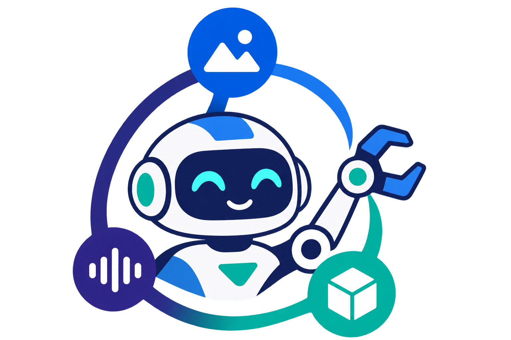

  
  <h1>RoboNexus</h1>
  
<strong>Connecting multimodal planning with robot action policies</strong>

  
<a href="README.md">中文</a> · English

  
Qwen-Agent · Qwen3-VL · Diffusion Transformer · CALVIN

RoboNexus is a personal exploration of agent-driven, long-horizon robot manipulation. A multimodal agent selects skills from the task and current scene; a bounded runtime invokes action policies and returns new observations and verification results for the next decision.

The system follows **observe → select a skill → execute → verify**. The agent handles semantic decisions, policies generate actions, and the runtime manages arguments, budgets and execution state.

## Architecture

This is a source-grounded architecture illustration, not a run screenshot. The current presentation covers the CALVIN backend, including simulator-assisted grounding and verification; it is not a claim of purely visual end-to-end operation. See the [data-flow notes](docs/presentation/data-flow.md) in Chinese.

## Project contributions

| Module | Implementation | Source |
| --- | --- | --- |
| Multimodal planning | Supplies task context, a skill catalog and static/wrist views to Qwen-Agent; selects tools and atomic skills, then continues, retries or aborts from feedback | [Agent adapter](RoboNexus-Agent/adapters/qwen_agent/single_skill_runner.py) |
| Skill–policy coordination | Connects DiT policies to CALVIN through skill registration, semantic grounding and policy routing; the backend selects the policy and runs a bounded action loop | [Execution tool](RoboNexus-Agent/core/tools/execute_skill.py) · [CALVIN executor](backends/calvin/execution/skill_executor.py) |
| Execution constraints and traces | Checks observation references, skill arguments and budgets; returns before/after observations and failure information, with structured events and persisted results | [Session](RoboNexus-Agent/core/runtime/session.py) · [Result store](RoboNexus-Agent/core/logging/result_store.py) |

## Task flow

1. **Observe:** interpret the language goal and current camera views against the available skill catalog.
2. **Ground:** bind semantic objects to the current observation.
3. **Execute:** validate the request and budget, route to a policy and step the CALVIN environment.
4. **Continue or finish:** return observations and results; let the agent continue, reground or retry, and confirm completion through `verify_goal`.

This describes code flow, not a successful recorded episode.

## Explore the code

- [Robot tools](RoboNexus-Agent/core/tools): inspect, ground, execute, verify and abort.
- [Agent adapters](RoboNexus-Agent/adapters/qwen_agent): multimodal messages and remote tool calls.
- [CALVIN backend](backends/calvin): environment integration, execution and verification.
- [Multitask DiT](multitask_dit_policy): low-level policy code and upstream documentation.
- [Tool protocol](docs/agent/QWEN_AGENT_TOOL_PROTOCOL.md): tool contracts and interface design.
- [Environment notes](envs/README.md): existing environment documentation.

[ARCHITECTURE.md](ARCHITECTURE.md) preserves early design context. Its optional perception components and older Orchestrator flow should not be read as the current agent execution path.

## Scope

This page presents system design and existing implementation. Historical videos and complete execution outputs have not been recovered, so no success rates, performance comparisons or task demos are claimed. Implemented interfaces are distinct from validated task performance.

## Acknowledgements

Built on [Qwen-Agent](https://github.com/QwenLM/Qwen-Agent), Qwen3-VL, [CALVIN](https://github.com/mees/calvin) and [Multitask DiT Policy](multitask_dit_policy/README.md). Project-specific work focuses on agent tool integration, skill/policy routing, execution constraints and feedback. Upstream models, frameworks and environments retain their own attribution and licenses.
