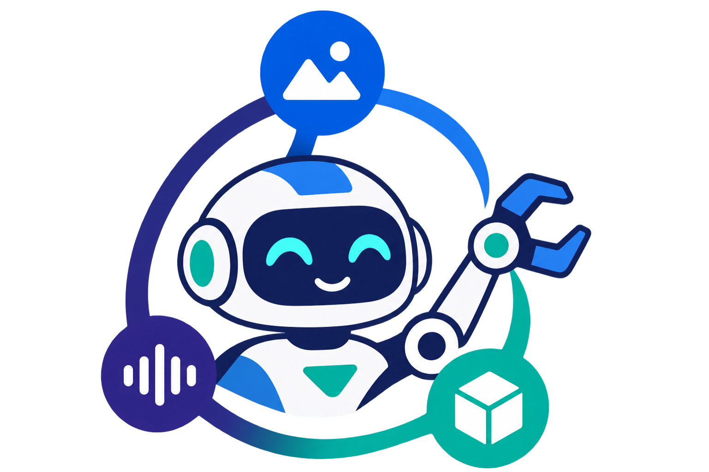

  
  <h1>RoboNexus</h1>
  
<strong>连接多模态任务规划与机器人动作策略</strong>

  
中文 · <a href="README.en.md">English</a>

  
Qwen-Agent · Qwen3-VL · Diffusion Transformer · CALVIN

RoboNexus 是一个面向长程操作任务的个人探索项目：让多模态 Agent 根据任务与当前场景选择机器人技能，由受约束的 Runtime 调用动作策略执行，再将新观测与验证结果交回 Agent，继续推进任务。

项目围绕 **“看见场景 → 选择技能 → 执行动作 → 检查结果”** 组织规划与控制。高层模型负责语义决策，底层策略负责动作生成，运行时负责参数、预算与执行状态。

## 系统架构

图为基于源码整理的架构示意，不是运行截图。当前展示以 CALVIN 后端为准；目标绑定与完成判定包含仿真辅助信息，不将其描述为纯视觉端到端系统。详细链路见 [源码与数据流说明](docs/presentation/data-flow.md)。

## 核心工作

| 模块 | 项目实现 | 源码入口 |
| --- | --- | --- |
| 多模态任务规划 | 将任务、技能目录、静态与腕部图像交给 Qwen-Agent；每次选择工具和原子技能，根据执行反馈继续、重试或终止 | [Agent 适配](RoboNexus-Agent/adapters/qwen_agent/single_skill_runner.py) |
| 技能与策略协同 | 通过技能注册、语义目标绑定和策略路由连接 DiT 策略与 CALVIN；高层选择技能，后端选择策略并执行有界动作循环 | [技能执行工具](RoboNexus-Agent/core/tools/execute_skill.py) · [CALVIN 执行器](backends/calvin/execution/skill_executor.py) |
| 执行约束与复盘 | 检查观测与目标引用、技能参数和执行预算；返回前后观测与失败信息，保存结构化事件和任务结果 | [Session](RoboNexus-Agent/core/runtime/session.py) · [结果持久化](RoboNexus-Agent/core/logging/result_store.py) |

## 一次任务如何推进

1. **观察与理解**：读取语言目标和当前双视角图像，结合可用技能目录选择下一步。
2. **绑定目标**：将语义对象与当前观测关联，为技能提供明确的操作对象。
3. **执行技能**：Runtime 检查请求与预算，路由到底层策略，驱动 CALVIN 动作循环。
4. **反馈与继续**：返回新观测和执行结果；Agent 决定继续、重新定位或重试，最终通过 `verify_goal` 确认任务完成。

这是代码流程说明，不代表某条任务的成功演示。

## 代码导航

- [机器人工具](RoboNexus-Agent/core/tools)：观察、目标绑定、执行、验证与终止。
- [Agent 与远程工具适配](RoboNexus-Agent/adapters/qwen_agent)：多模态消息和工具调用。
- [CALVIN 后端](backends/calvin)：环境接入、策略执行与任务验证。
- [Multitask DiT](multitask_dit_policy)：底层策略代码及上游说明。
- [工具协议](docs/agent/QWEN_AGENT_TOOL_PROTOCOL.md)：工具输入输出与接口设计。
- [环境说明](envs/README.md)：现有环境组织文档。

根目录 [ARCHITECTURE.md](ARCHITECTURE.md) 保留早期设计背景；其中可选感知模块和旧 Orchestrator 流程不等同于当前 Agent 主链路。

## 展示范围

本页展示系统设计和已存在的代码实现。历史运行视频与完整输出目前未恢复，因此不提供成功率、性能对比或任务演示，也不将接口实现等同于任务效果验证。

## 致谢

本项目基于 [Qwen-Agent](https://github.com/QwenLM/Qwen-Agent)、Qwen3-VL、[CALVIN](https://github.com/mees/calvin) 与 [Multitask DiT Policy](multitask_dit_policy/README.md) 等开源工作开展。个人工作重点是 Agent 工具接入、技能与策略路由、执行约束和反馈链路的组织；上游模型、框架及环境保留各自来源与许可证。
